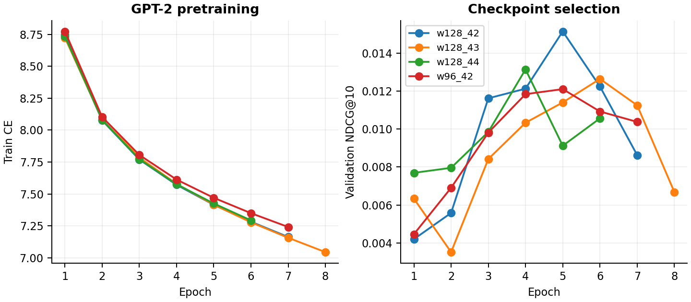
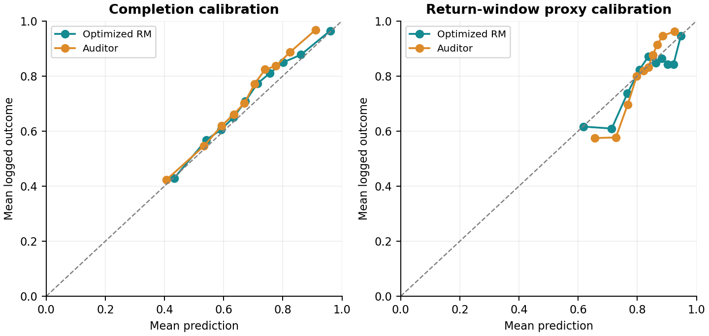
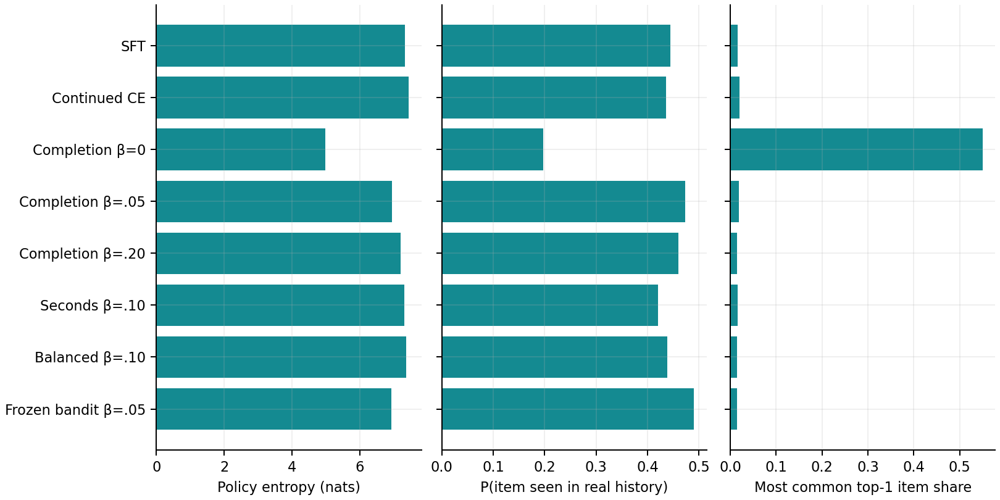

# RL для последовательных рекомендаций

## RL для последовательных рекомендаций

Второе задание. Реальный эксперимент на Yambda: GPT-2 по ID треков, предиктор доли дослушивания и on-policy REINFORCE. Все числа ниже получены запуском приложенного кода; положительный эффект RL не предполагался заранее.

Первичное сравнение: balanced RL против continued-CE. NDCG@10: 0.00686 → 0.00679. Δ и 95% ДИ: -0.00008 [-0.00107; +0.00084]. Интервал не подтверждает рост релевантности.

Изменение ожидаемого completion основной RM: +0.00297 [+0.00264; +0.00328]; аудиторской RM: +0.00158 [+0.00136; +0.00180]. Обе величины — предсказания моделей на предлагаемых действиях, а не наблюдаемый пользовательский эффект.

По заранее заданному правилу confirmation выбран Balanced, β=.10. Это решение принято до вычисления финальных test metrics. Первичное сравнение от выбора не меняется.

Масштаб: 4,889,035 записей, 1000 случайных слушателей, словарь 16 384 трека, три seed обучения. Семь вариантов дообучения, frozen SFT и два простых контроля. CPU, без предобученных текстовых весов.

Отчёт отвечает на пять вопросов: изменение поведения; сохранение релевантности и коллапс; долгосрочные цели; ошибки перехода при пяти шагах; компромисс между reward и точностью. Код и команды находятся в README.md. Дата: 24 октября 2026.

## 1. Данные и доступная информация

Источник — yandex/yambda, sequential/50m/listens.parquet, закреплённая revision dd6f3a19eef5866e346c3270e098baa641a44948. Равномерно выбраны 1000 из 9238 пользователей, имеющих строку listens, seed 314. Дополнительного фильтра по активности нет. Сохранены все предоставленные listening events этих пользователей; другие типы действий не скачивались.

Медиана истории 2752 событий; минимум 12. Органическая доля 52.1%. Повторы и 23,038 точных дубликатов сохранены. Они могут отражать особенности источника; для reward label одинаковые user/time/item объединяются средним.

Время — секунды от начала наблюдения с округлением до 5 секунд. 981,971 записей имеют уже встречавшийся user/timestamp. Их порядок неизвестен. Префикс всегда timestamp < t. В прошлых группах используется техническая сортировка item ID. Все цели неоднозначных timestamp-групп исключены из LM loss, но остаются в истории и групповых оценочных целях.

Общая временная граница одинакова для всех пользователей. Три последние недели — validation, confirmation и test. Во время оценки доступна реально наблюдённая история до текущего запроса, включая более ранние события этой недели; веса фиксированы. Это prequential-протокол, а не замороженная история на начало недели.

Словарь — top-16 384 по частоте только в train. Остальные ID сохраняются как UNK; PAD/BOS/UNK запрещены среди рекомендаций. Длительность — train median по треку, предполагается доступным стабильным метаданным. Полные истории сохранены, GPT видит до 64 токенов в базовом запросе.

Vocabulary, embeddings и глобальная популярность — фиксированные параметры/статистики, выученные ко времени train_end. Более ранние train-префиксы преобразуются ими ретроспективно; не утверждается их доступность в исторический момент каждого train row. В validation/test они уже известны до начала периода. RL обучается на прошлых префиксах с каталогом train_end, а не воспроизводит исторические deployment policies; для такой задачи потребовался бы release-time каталог.

| Часть | Начало, включено | Конец, исключён | Запросы | Покрытие целей |
| --- | --- | --- | --- | --- |
| train | 0 | 24185590 | 12000 | 93.2% |
| validation | 24185590 | 24790390 | 512 | 54.9% |
| confirmation | 24790390 | 25395190 | 1024 | 51.8% |
| test | 25395190 | 25999990 | 2048 | 52.7% |

## 2. GPT-2 и честное сравнение

GPT2LMHeadModel обучен с нуля: 2 causal decoder layers, 4 attention heads, width 128 (выбор из 96/128 по validation NDCG@10), tied input/output embeddings. Токен — ID трека. Dropout .1 при SFT; AdamW lr .001, batch 32, до 8 эпох, patience 2, clip gradient norm 1.

В SFT выбраны 30 000 перекрывающихся окон (stride 32) из train. Всего 645,171 допустимых target positions на эпоху с учётом повторов в окнах. Loss — next-token CE только для известных, неорганических и однозначных по времени целей. Органические события и UNK входят в контекст. У коротких историй BOS и левый padding; loss на padding отсутствует.

SFT checkpoint выбирается по validation. Для выбранной архитектуры обучены отдельные seed 42/43/44. Все варианты дообучения внутри seed стартуют с одной и той же сохранённой SFT. Continued-CE получает те же 300 updates и те же начальные префиксы. Его set loss = −log Σ_{i∈P_t} π(i|s_t), где P_t — известные неорганические цели timestamp-группы; при одной цели это обычный CE. Тот же loss используется в balanced auxiliary term. Это контроль дополнительного обучения; число FLOPs, actions и затраты времени не приравниваются.

Оценочный запрос — user/timestamp с неорганическими событиями; положительные объекты — уникальные неорганические item ID этой группы. Ранжирование точное по всем 16 384 доступным трекам, без sampled negatives. Повторы разрешены: в музыке знакомый трек может быть релевантен. Поэтому repeat — диагностика, а не автоматически ошибка.

Оценочные запросы равномерно сэмплируются без возвращения из всех подходящих timestamp-групп: 512/1024/2048 на validation/confirmation/test. Для 12 000 RL/continued-CE train states дополнительно требуется хотя бы одна known positive, чтобы определить CE loss. Во временных holdout такого фильтра нет; полностью OOV-запросы сохраняются. Для всех методов используются одни и те же cached queries.

В test 2048 запросов у 434 пользователей; 931 запросов полностью вне словаря. Общие Recall/NDCG/MAP@5/10/20 включают OOV-цели с нулевым вкладом. Conditional-метрики делят только на известные цели и исключают полностью OOV-запросы. Это разные estimands.

Query-macro NDCG использует бинарную релевантность, ideal DCG по min(K, число всех целей); MAP — сумму precision на hit-позициях, делённую на min(K, число целей). Для conditional вариантов знаменатели пересчитываются по known targets. Дополнительные контроли: train popularity и .9*частота в текущем контексте + .1*train popularity.

Позитивом считается любой logged неорганический listen, включая малый completion. Поэтому ranking metrics измеряют matching исторических действий logging policy, а не экспертную или причинную удовлетворённость. Снижение NDCG само по себе не доказывает ухудшение пользовательского опыта; концентрация и другие диагностики помогают понять характер изменения.

## 3. Reward model: качество на logged actions

Основная цель — clip(played_ratio_pct/100, 0, 1). В источнике ratio >100 означает повторное воспроизведение; clipping — выбранная функция полезности, а не исправление ошибочных данных. Входы: ID кандидата и последнего трека, train duration/popularity, число прошлых событий, повторы, статистики последних ID, PCA-16 embeddings и сходство кандидата с профилем.

Текущий played_ratio, completion и будущее поведение отсутствуют во входах. Embeddings фиксированы из SFT seed 42. Completion — ансамбль трёх CatBoost RMSE, depth 8, максимум 350 trees, lr .06; depth 6/8 и early stopping 40 выбираются только на validation. Дополнительные два члена используют bootstrap weights по пользователям.

Отклики оптимизируемой RM обучены на 60,820 train rows одной случайной половины пользователей; ExtraTrees-аудитор — на 59,180 rows другой половины. Разделены response labels, но обе модели используют общее фиксированное представление из SFT. Аудитор не участвует в RL loss или выборе checkpoint. Это проверка чувствительности к surrogate, а не независимая истина.

Для каждого reward row и completion, и 48-часовой return label должны полностью наблюдаться внутри своего split; учитывается консервативное время завершения текущего трека. Reward test содержит 20 000 реальных logged действий с известными item ID. Это условная предиктивная оценка на logging distribution; на новых действиях после RL калибровка не гарантирована.

Обучение RM условно на наличии записи listens. Она не оценивает вероятность принять рекомендацию при показе: в выбранном файле нет непрослушанных показов. Поэтому expected completion политики предполагает, что отклик на предлагаемый объект сопоставим с откликом на logged listen; эту selection/transition гипотезу офлайн-метрики не проверяют.

Top-decile bias — среднее prediction минус outcome среди верхнего дециля данного предиктора. Для константного baseline это все строки из-за ties. Полные calibration tables, predicted/observed values и результаты return proxy сохранены отдельно.

| Completion model | MAE | RMSE | R² | Top-decile bias |
| --- | --- | --- | --- | --- |
| optimized_rm | 0.3338 | 0.3860 | 0.1357 | -0.0041 |
| audit_rm | 0.3425 | 0.3868 | 0.1321 | -0.0567 |
| global_mean | 0.3920 | 0.4183 | -0.0153 | -0.0513 |
| train_item_mean | 0.3789 | 0.4130 | 0.0103 | -0.0325 |

## 4. RL: функция цели и обновление

Используется on-policy grouped REINFORCE с baseline из трёх других траекторий того же реального префикса. На update выбираются 16 train states, по 4 траектории, по 5 действий. Полный softmax по словарю, temperature 1, gamma .9, AdamW lr .0001, 300 updates, clip norm 1. Для каждого RL run сэмплируются 96 000 действий.

На шаге t: shaped reward = r_t − β log(π(a_t|s_t)/π_SFT(a_t|s_t)). Return-to-go G_t = Σ_{j≥t} γ^(j−t) shaped_reward_j. Advantage — G_t минус средний return остальных трёх независимых rollouts. Loss = −mean(Σ_t γ^t A_t logπ_t)/Σ_t γ^t. Sampling и gradient replay используют одну текущую политику без dropout; после update rollout больше не используется. При continued-CE dropout также выключен, gradient update остаётся включённым.

При append выбранный ID добавляется в контекст как предположение surrogate среды. В frozen bandit состояние не меняется, а baseline строится по немедленным rewards, поскольку действия не имеют будущих последствий. Это matched по числу actions/updates контроль контекстных переходов, а не ещё одна реалистичная модель пользователя.

Completion сравнивается при β=0/.05/.20. Seconds reward = min(duration,600)*completion/300. Balanced = .7*completion + .2*return_proxy + .1*novelty − .25*recent_repeat − .1*RM_std; novelty = 1 − log(1+train_count)/log(1+max_count). Для balanced добавлен .05*CE по реальным целям. Коэффициенты заданы до RL и не подбирались по test.

Checkpoints 100/200/300: максимум собственной ожидаемой validation utility. Balanced сначала требует ≥95% SFT validation NDCG, иначе берёт лучший NDCG и отмечает провал ограничения. Continued-CE выбирается по validation NDCG. Ожидаемые rewards оцениваются 32 Monte Carlo действиями на запрос с общими uniforms для всех политик; ranking считается точно.

Frozen SFT задаёт KL reference, а RM и embeddings не обновляются во время RL. У всех вариантов идентичный каталог и исходные checkpoints. В конфигурации сохранены seeds, horizons, коэффициенты и правило выбора.

| Вариант | Шаги seed 42/43/44 | Validation NDCG | SFT floor |
| --- | --- | --- | --- |
| Continued CE | 100 / 200 / 100 | 0.01479 | не задан |
| Completion, β=0 | 300 / 300 / 300 | 0.00025 | не задан |
| Completion, β=.05 | 300 / 300 / 300 | 0.01026 | не задан |
| Completion, β=.20 | 300 / 300 / 300 | 0.01325 | не задан |
| Секунды, β=.10 | 300 / 300 / 300 | 0.01227 | не задан |
| Balanced, β=.10 | 300 / 300 / 200 | 0.01377 | 3/3 |
| Bandit, β=.05 | 300 / 300 / 300 | 0.01147 | не задан |

## 5. Релевантность и компромисс с наградой

В таблице — среднее метрик трёх отдельных моделей. Вероятности не ансамблируются. Reward означает ожидаемый completion оптимизируемой RM при sample temperature 1; Audit — то же по аудиторской RM. Эти scores относятся к предлагаемым действиям, а NDCG — к фактическим действиям в логах.

NDCG mean ± SD по seed: SFT 0.00688 ± 0.00071; continued-CE 0.00686 ± 0.00056; balanced 0.00679 ± 0.00120. Полные отдельные seed и все K доступны в summary.json.

Простые контроли: popularity NDCG 0.00169, recent-frequency 0.00490; SFT 0.00688. Completion с β=.20 даёт средние NDCG 0.00706 и RM 0.6981; frozen-bandit — 0.00725 и 0.7058. Эти дополнительные test точки описательны и не меняют решение на confirmation.

Первичное balanced − continued-CE: NDCG -0.00008 [-0.00107; +0.00084], reward +0.00297 [+0.00264; +0.00328], audit reward +0.00158 [+0.00136; +0.00180]. Bootstrap парный по пользователям, 2000 повторов; сначала усредняются per-query метрики трёх matched seed. Все запросы resampled пользователя идут вместе. Интервалы условны на этих трёх обучениях и общих MC draws; не учитывают всю вариативность train samples/seed.

Confirmation правило: порог NDCG 0.00568; прошли Секунды, β=.10, Balanced, β=.10. Выбран Balanced, β=.10, test NDCG 0.00679, reward 0.6953. Описание этого результата не заменяет первичное сравнение.

Эмпирический Pareto frontier вычислен по средним test NDCG и optimizer reward. Это описательный анализ, не новое правило выбора модели. Дополнительные интервалы и сравнения исследовательские, без поправки на множественные проверки; отсутствие значимости не доказывает эквивалентность и порог 95% не является статистическим non-inferiority тестом.

Reward functions имеют разные шкалы: completion в [0,1], seconds после деления на 300 может достигать 2. Поэтому одинаковый β между разными functions не означает одинаковую силу ограничения относительно reward. Balanced меняет несколько компонентов и добавляет CE одновременно; этот эксперимент не выделяет причинный вклад каждой составляющей по отдельности. Для этого нужен отдельный factorial/ablation протокол.

| Модель | NDCG@10 | Recall@10 | MAP@10 | RM | Audit |
| --- | --- | --- | --- | --- | --- |
| Популярность | 0.00169 | 0.00309 | 0.00095 | 0.6471 | 0.6487 |
| Частота в контексте | 0.00490 | 0.00842 | 0.00334 | 0.6944 | 0.6816 |
| SFT GPT-2 | 0.00688 | 0.01542 | 0.00412 | 0.6925 | 0.6780 |
| Continued CE | 0.00686 | 0.01546 | 0.00408 | 0.6923 | 0.6778 |
| Completion, β=0 | 0.00157 | 0.00326 | 0.00107 | 0.7346 | 0.6940 |
| Completion, β=.05 | 0.00669 | 0.01316 | 0.00451 | 0.7089 | 0.6867 |
| Completion, β=.20 | 0.00706 | 0.01494 | 0.00442 | 0.6981 | 0.6809 |
| Секунды, β=.10 | 0.00553 | 0.01167 | 0.00344 | 0.6906 | 0.6763 |
| Balanced, β=.10 | 0.00679 | 0.01505 | 0.00406 | 0.6953 | 0.6794 |
| Bandit, β=.05 | 0.00725 | 0.01544 | 0.00453 | 0.7058 | 0.6851 |

## 6. Как меняется поведение и есть ли коллапс

Без KL: entropy 7.336 → 4.987 nats; доля самого частого top-1 1.6% → 55.0%; вероятность уже знакомого трека 44.4% → 19.7%. Эти измерения показывают масштаб изменения распределения, но не объясняют причину сами по себе.

Ожидаемая длительность трека: SFT 188.3s, completion β=0 139.1s, seconds 204.1s. Длину рекомендуется рассматривать совместно с reward и релевантностью: выбор более длинного объекта сам по себе не означает большего времени реального прослушивания.

Вероятность выбрать трек без единого собственного train response label основной RM: SFT 7.9%, completion β=0 1.8%, balanced 7.8%. Такие треки известны GPT-2 и имеют метаданные, но RM обобщает на них без item-specific откликов. Среднее |optimizer−auditor| на sampled actions: SFT 0.0842, β=0 0.0843.

Среди фактических test targets 63.2% уже встречались в полной предыдущей истории; среди known targets — 71.3%. Это свойство музыкальных логов объясняет, почему штраф за повторы может конфликтовать с matching-next-item NDCG. Оно не доказывает, что повторы полезны каждому пользователю или что разнообразие ухудшает удовлетворённость.

Coverage — доля словаря, появившаяся в top-10 хотя бы одного запроса. Exposure Gini — неравномерность top-10 показов по словарю. Top1 share — доля запросов с самым частым первым объектом. Cross-user Jaccard — сходство top-10 разных пользователей (первый из отобранных запросов пользователя; фиксированные случайные пары). Высокая concentration совместно со сходством выдач диагностирует обезличивание.

RM_std измеряет расхождение bootstrap-моделей, а optimizer/auditor gap — чувствительность к другому предиктору. Ни один показатель по отдельности не доказывает reward hacking. Для такого вывода нужны реальные outcomes на новых действиях либо рандомизированная онлайн-проверка. Контроль train-item-mean помогает увидеть, насколько RM превосходит простую популярностную оценку отклика.

В этом запуске вариант без KL смещается к более коротким трекам и общей выдаче для разных пользователей. Это частичный глобальный коллапс; вероятность повторить знакомый пользователю трек при этом снижается. Повтор знакомого объекта, повтор внутри сгенерированного списка и один общий объект у разных пользователей — разные явления. Balanced штрафует повторы только в последних 64 токенах, тогда как таблица P(repeat) использует всю прошлую историю.

| Модель | Покрытие | Gini | Top1 share | Jaccard | Repeat P |
| --- | --- | --- | --- | --- | --- |
| Популярность | 0.1% | 0.999 | 100.0% | 1.000 | 14.2% |
| Частота в контексте | 28.0% | 0.878 | 1.8% | 0.007 | 91.1% |
| SFT GPT-2 | 23.7% | 0.898 | 1.6% | 0.004 | 44.4% |
| Continued CE | 22.7% | 0.905 | 2.0% | 0.004 | 43.5% |
| Completion, β=0 | 1.0% | 0.998 | 55.0% | 0.358 | 19.7% |
| Completion, β=.05 | 19.9% | 0.922 | 1.8% | 0.005 | 47.3% |
| Completion, β=.20 | 22.7% | 0.904 | 1.5% | 0.004 | 46.0% |
| Секунды, β=.10 | 22.9% | 0.902 | 1.6% | 0.003 | 42.0% |
| Balanced, β=.10 | 23.3% | 0.899 | 1.4% | 0.003 | 43.8% |
| Bandit, β=.05 | 21.0% | 0.914 | 1.5% | 0.004 | 49.0% |

## 7. Пять шагов: рекомендация не равна действию

Диагностика использует 256 test-префиксов с пятью следующими одиночными неорганическими событиями и разрывами ≤30 минут. Это специальный срез непрерывных рекомендационных последовательностей; результаты не обобщаются на все сессии. Сравниваются: фактический префикс на каждом шаге; слепое добавление каждого top-1; неизменный префикс; принятие с вероятностью predicted completion.

Все четыре режима начинают с одного реального состояния. Политика в диагностике выбирает top-1, тогда как RL использовал stochastic sampling. В model-acceptance режиме общие uniforms; отклонённый ID не попадает в историю. Это эвристика перехода, а не обученная и проверенная модель принятия рекомендации: дослушивание и выбор объекта — разные события.

NDCG_anchor сравнивает выдачу с реально следующим logged item при разных искусственных контекстах. После первого шага это stress test согласованности с фактической траекторией, а не unbiased counterfactual relevance. Реальный пользователь при новой рекомендации мог выбрать другое действие или уйти; его последующие фактические действия нельзя считать outcomes новой политики.

KL к teacher-forced контексту измеряет накопившийся сдвиг распределения рекомендаций, same-top1 — долю совпадений первого объекта, within-list repeat — повтор среди уже предложенных объектов. RM на синтетических историях может становиться чрезмерно уверенной даже при ухудшении anchor relevance. Для реалистичного session return нужны отклик, organic transition, пропуски и stop/return model, а затем онлайн-валидация.

Наблюдаемый шаг 5 выбранной модели: append anchor NDCG 0.00210 против 0.00768 при actual prefix; KL=0.409. Greedy RM completion 0.6916 против actual-prefix 0.7710. Здесь в greedy режиме синтетический переход снижает и anchor matching, и RM score; рост награды на каждом шаге не наблюдается.

| Выбранная модель, шаг 5 | Anchor NDCG | RM top1 | Audit top1 | KL к actual |
| --- | --- | --- | --- | --- |
| append_all | 0.00210 | 0.6916 | 0.7146 | 0.4092 |
| frozen | 0.00367 | 0.7714 | 0.7358 | 0.2679 |
| model_acceptance | 0.00232 | 0.6975 | 0.7176 | 0.3903 |
| teacher_forced | 0.00768 | 0.7710 | 0.7338 | 0.0000 |

## 7а. Ожидаемая награда пяти stochastic шагов

Отдельная дополнительная диагностика соответствует sampling temperature 1 при обучении. Начальные 256 запросов случайно выбраны из общего test sample без отбора по будущему продолжению сессии. На запрос и seed — четыре траектории, пять шагов, gamma .9. В таблице нормированный return Σγ^t r_t / Σγ^t; это шкала среднего completion, а не суммарные реальные минуты.

Для append-среды первичная разность balanced − continued-CE: +0.00620 [+0.00502; +0.00750]. Интервал по пользователям условен на этих моделях и четырёх общих MC draws. Его нельзя переносить на реальное поведение пользователей.

Под одним и тем же фиксированным набором весов проверяются append и frozen переходы. Различия показывают чувствительность surrogate return к модели контекстного перехода. Это не причинное сравнение пользовательских сценариев; обе динамики искусственные. Predicted return proxy на пяти шагах относится к перекрывающимся будущим окнам, поэтому его сумму нельзя интерпретировать как пять независимых возвращений.

Эта диагностическая оценка была добавлена после начала validation запусков, до test metrics; выбор моделей не использует её результаты. Основной EXPERIMENT_PLAN.md сохранён, дополнение записано в DIAGNOSTIC_PLAN.md. Checkpoints выбирались по first-step validation utility, хотя training return имеет horizon 5 — дополнительное ограничение согласования train/selection objectives.

| Модель | Переход | G5 RM | G5 Audit | Repeat в списке |
| --- | --- | --- | --- | --- |
| Continued CE | append | 0.6976 | 0.6875 | 0.5% |
| Continued CE | frozen | 0.6966 | 0.6872 | 0.3% |
| Balanced, β=.10 | append | 0.7038 | 0.6910 | 0.4% |
| Balanced, β=.10 | frozen | 0.6992 | 0.6886 | 0.4% |
| Completion, β=0 | append | 0.7744 | 0.7241 | 8.3% |
| Completion, β=0 | frozen | 0.7374 | 0.7009 | 6.6% |
| SFT GPT-2 | append | 0.6981 | 0.6878 | 0.4% |
| SFT GPT-2 | frozen | 0.6966 | 0.6874 | 0.4% |

## 8. Долгосрочные цели: что доступно офлайн

Return proxy y=1, если после текущего действия наблюдалось любое listening event в интервале (t+24h,t+48h]. Окно не пересекает границу split. Вторая CatBoost-голова предсказывает этот label по прошлой истории и кандидату; balanced reward даёт ей вес .2. Это наблюдаемая будущая активность, а не вероятность причинного удержания от выбранного трека.

Для настоящей долгосрочной цели можно задавать discounted return: дослушивания + разнообразие/новизна + индикатор возвращения − риск ухода, либо обучать отдельную survival/stop модель с корректным censoring. Нужны активные дни, длина/завершение сессии, organic activity, skips и отрицательная обратная связь; желательно также экспозиции и propensities. В этой работе скачаны только listens, поэтому skips/likes не восстановлены.

Важное ограничение Yambda: исходный cohort выбран по активности в первых десяти месяцах и наличию действия в последнем. Наша равномерная подвыборка не устраняет этот survivorship bias. Высокая доля return labels не описывает churn всей аудитории. Окно 24–48h не означает отдельный вход в приложение и не измеряет удовлетворённость.

Офлайн можно проверить предиктивное качество proxy, временную устойчивость, поведение политики, чувствительность к reward и коллапс. Нельзя заключить, что изменение предсказанного return увеличило фактический retention. Нет истинных logging propensities или рандомизации: IS/DR, unbiased OPE и causal effect здесь не заявляются.

Онлайн-проверка: user-level randomized A/B, заранее зафиксированные eligible cohort и горизонты, primary D7/D14 return/active days, duration/completion как вторичные, guardrails на skips, однообразие и жалобы. Размер и длительность определяются по baseline rates и минимальному эффекту до запуска; в этой работе A/B не проводился.

В первичном сравнении Δ expected return-proxy = -0.00005 [-0.00018; +0.00005]. Интервал включает ноль: даже рост этого модельного proxy здесь не подтверждён. Это более узкий вывод, чем утверждение об отсутствии любого влияния на реальное удержание.

| Return model | ROC-AUC | PR-AUC | Brier | Logloss | Observed rate |
| --- | --- | --- | --- | --- | --- |
| optimized_rm | 0.6655 | 0.8779 | 0.1510 | 0.4750 | 79.9% |
| audit_rm | 0.7325 | 0.9113 | 0.1469 | 0.4575 | 79.9% |

## 9. Стоимость, надёжность и воспроизведение

Среда: Python 3.9.6, Torch 2.5.1, Transformers 4.53.2, CatBoost 1.2.10; CPU, 4 threads на процесс. SFT grid и три итоговых seed: 75.2 минут чистого fit. Reward model fits: 0.9 минут; суммарный fit дообучений 57.8 минут. Это сумма измеренных fit times, без скачивания/подготовки/всей оценки и не оценка FLOPs.

Для RL отдельно записаны 96 000 sampled actions/run, optimizer updates, время и число CE positive targets. Для continued-CE число labels меньше, чем число RL actions: одинаковое число обновлений не даёт равный computational budget. Отдельный baseline замороженной SFT позволяет оценить, добавило ли обычное дообучение пользу.

Часть fits выполнялась параллельно и конкурировала за CPU; это не изолированный hardware benchmark. Для RL seed 43/44 отключён idle busy-wait OpenMP (OMP_WAIT_POLICY=PASSIVE, KMP_BLOCKTIME=0), при тех же четырёх вычислительных threads; runtime_scheduling.json фиксирует различие. Суммарные fit times исключают прерванные инженерные прогоны и не равны всему времени разработки.

Аудит сравнил все 4,889,035 записей 1000 выбранных пользователей с исходным parquet, восстановил все 30,000 LM окон и проверил masking. Для всех cached states проверено history_max < timestamp; по 256 примеров каждого split/kind точно восстановлены prefix, seen mask и labels. SHA источника и моделей проверены; saved test means пересчитаны из per-query CSV.

Восемь unit tests проверяют timestamp ties, causal replay и KV cache, masked labels, discount/leave-one-out baseline и направление градиента, OOV denominator, RM feature fractions и reward objectives. Tests не заменяют data audit. Упакованный архив содержит код, конфигурацию, планы, отчёт и компактные результаты; raw data, большие cache и обученные веса исключены.

Полное воспроизведение: создать Python 3.9+ environment, установить requirements.txt, выполнить make reproduce. Публичный parquet ~426 MB скачивается по закреплённой revision и проверяется SHA. Рекомендуется около 10 GB свободного диска и 16–32 GB RAM; этот запуск выполнен на машине с 32 GB. Точное время зависит от CPU и библиотек. Команда demo печатает top-10 реального heldout prefix после обучения.

Cache reuse проверяет config, source и model hashes; при изменении дизайна нужно новое output_dir. Текущие JSON содержат относительные пути внутри проекта. Reproduction сохраняет новый selection seal до test. Публикация или отправка работы не выполнялась.

## 10. Связь со статьями и ограничения

Petrov & Macdonald (2024), Aligning GPTRec with Beyond-Accuracy Goals with Reinforcement Learning: sequential Next-K и оптимизация свойств списка через RL; teacher-student pretraining и PPO. Здесь реализовано требуемое заданием next-item обучение GPT-2 и REINFORCE, поэтому это самостоятельный небольшой эксперимент по близкой идее, не буквальная репликация GPTRec. Источник: https://arxiv.org/abs/2403.04875

Matveev et al. (2026), Session-Level Optimization for Large-Scale Retrieval using REINFORCE with Multi-Step Off-Policy Correction: session rewards, feedback model и многошаговая коррекция off-policy обучения retrieval. Здесь нет их two-tower архитектуры, logged propensities или multi-step IS; actions сэмплируются on-policy в фиксированной surrogate среде. Авторы также различают model-based scores и реальные результаты. Источник: https://arxiv.org/abs/2607.02818

Описание Yambda и формулы времени: https://arxiv.org/abs/2505.22238 ; dataset card: https://huggingface.co/datasets/yandex/yambda . Pinned file URL и SHA находятся в data/SOURCE_MANIFEST.json. Код использует поля listens, is_organic, played_ratio_pct и track_length_seconds.

Ограничения: небольшая GPT-2 и ограниченные CPU budgets; 1000 пользователей и зависимые повторные события; словарь покрывает около половины test targets; arbitrary order внутри уже прошлых tied blocks; метаданные трактуются как стабильные; response модели оцениваются на логах другой политики; surrogate transitions и acceptance не валидированы; return proxy условен на активном исходном cohort; три seed и user-bootstrap не покрывают всю неопределённость.

Дизайн не был полностью слепым к составу holdout: до первого обучения словарь 2048 заменён на 16 384 после аудита train coverage/CPU benchmark; проверялось и покрытие heldout target IDs. Model metrics при этом не вычислялись. Пилот 2048 сохранился как data-only design audit и не используется для выбора лучшего результата. Все последующие model choices заданы в EXPERIMENT_PLAN.md и selection.lock.json.

Практический вывод следует из совместного рассмотрения релевантности, концентрации, двух reward estimators и устойчивости контекста. Рост surrogate reward достаточен для подтверждения работы оптимизатора, но недостаточен для заявления об улучшении пользовательского опыта. Следующий этап — более широкий item vocabulary, независимый временной/пользовательский cohort, richer feedback и онлайн-проверка.

## 11. Основные выводы

Оптимизатор способен менять поведение: completion без KL повышает ожидаемую RM награду с 0.6925 до 0.7346, но NDCG меняется с 0.00688 до 0.00157. Средняя длительность сокращается до 139.1s, самый частый top-1 занимает 55.0% запросов. Это полезный отрицательный результат: модельная награда и matching наблюдавшихся действий расходятся.

Balanced выбран до test и даёт небольшой прирост по основной и аудиторской RM. Первичный Δ NDCG -0.00008 [-0.00107; +0.00084]: точечная оценка близка к CE, но это не доказательство эквивалентности. Потеря 5% от CE соответствует -0.00034; интервал Δ шире этого масштаба. Для убедительной проверки допустимой потери нужны больше независимых пользователей/периодов и заранее рассчитанная мощность.

Более сильный KL сохраняет персонализацию ценой меньшего reward gain; seconds сдвигает длину объектов, а balanced меняет несколько целей одновременно. Frozen-bandit остаётся конкурентным описательным контролем: само добавление пяти сгенерированных ID не гарантирует пользы многошагового RL.

Долгосрочный proxy предсказуем лишь умеренно и не дал подтверждённого роста в первичном сравнении. Сдвиг пятишагового контекста заметен и зависит от decoding/transition assumptions. Следующий содержательный шаг — проверенная модель принятия/ухода, более широкий каталог и независимый cohort; вывод о реальном пользовательском эффекте требует онлайн-эксперимента.

## Дополнительные таблицы

По каждому seed, все K и conditional metrics: artifacts/main/evaluation/test/summary.csv и summary.json. Парные интервалы: paired_comparisons.json. Все validation checkpoints и training diagnostics: curve_*.json. Пять шагов и все modes: evaluation/rollouts/summary.csv.

| Модель | NDCG@10 mean ± SD | Conditional NDCG@10 | KL к SFT |
| --- | --- | --- | --- |
| Популярность | 0.00169 ± 0 | 0.00347 | — |
| Частота в контексте | 0.00490 ± 0 | 0.00965 | — |
| SFT GPT-2 | 0.00688 ± 0.00071 | 0.01309 | 0.0000 |
| Continued CE | 0.00686 ± 0.00056 | 0.01296 | 0.0341 |
| Completion, β=0 | 0.00157 ± 0.00007 | 0.00287 | 5.6628 |
| Completion, β=.05 | 0.00669 ± 0.00113 | 0.01265 | 0.2479 |
| Completion, β=.20 | 0.00706 ± 0.00139 | 0.01341 | 0.0266 |
| Секунды, β=.10 | 0.00553 ± 0.00164 | 0.01060 | 0.1697 |
| Balanced, β=.10 | 0.00679 ± 0.00120 | 0.01296 | 0.0369 |
| Bandit, β=.05 | 0.00725 ± 0.00085 | 0.01391 | 0.1188 |