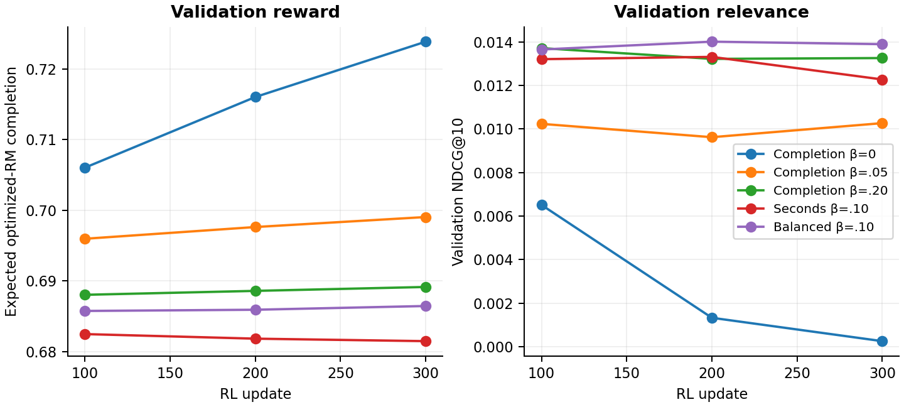
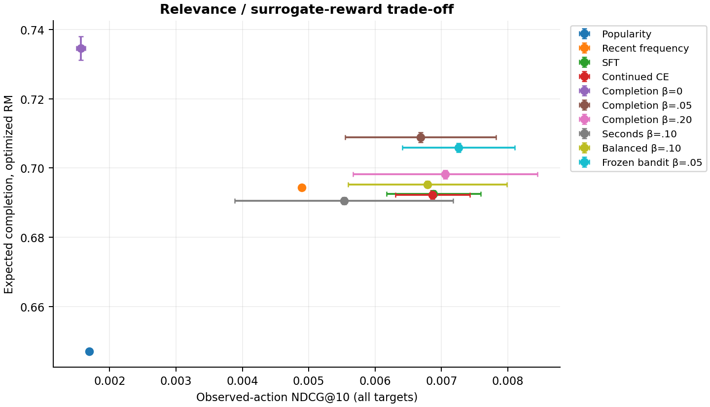
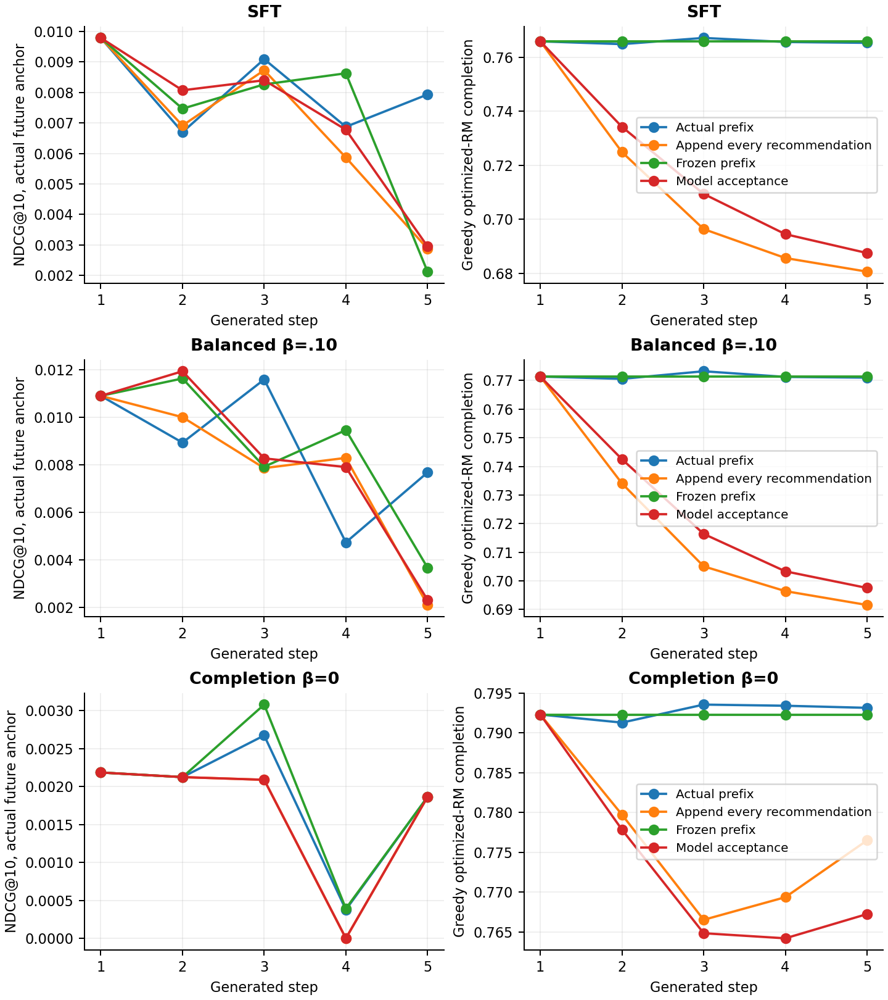

# GPT-2 и RL на Yambda

[README](README.md) · [LaTeX](report/main.tex) · [Воспроизведение](docs/REPRODUCING.md)

## Данные и протокол

Из [Yambda-50M](https://huggingface.co/datasets/yandex/yambda) равномерно выбраны 1 000 из 9 238 пользователей файла listens с seed 314. Сохранены все 4 889 035 их прослушиваний, медианная длина истории составляет 2 752 события. Другие типы действий не использовались. Органические прослушивания входят в контекст, целями служат неорганические события

Время задано в секундах с округлением до 5 секунд. Запрос соответствует пользователю и моменту целевого события. Его история содержит только события со строго меньшим временем. Неоднозначные цели с одинаковым временем исключены из функции потерь GPT-2, при оценке такая группа задаёт множество релевантных ID

Последние три недели разделены на validation, confirmation и test, все более ранние события отнесены к train. Во время оценки история пополняется реальными событиями до текущего запроса, веса фиксированы. Словарь содержит 16 384 наиболее частых трека из train, остальные ID преобразуются в UNK. Служебные PAD, BOS и UNK запрещены в выдаче

**Временные границы в секундах и фиксированные выборки запросов**

| Часть | Время, левая граница включена | Правая граница исключена | Запросы | Покрытие целей |
| --- | --- | --- | --- | --- |
| train | 0 | 24 185 590 | 12 000 | 93.2% |
| validation | 24 185 590 | 24 790 390 | 512 | 54.9% |
| confirmation | 24 790 390 | 25 395 190 | 1 024 | 51.8% |
| test | 25 395 190 | 25 999 990 | 2 048 | 52.7% |

В test представлены 434 пользователя, у 931 запроса все цели вне словаря. Общие Recall, NDCG и MAP учитывают все цели, вклад неизвестных ID равен нулю. Ранжируется весь фиксированный словарь без выборки отрицательных объектов. Для train-запросов требуется хотя бы одна известная цель, чтобы определить дополнительную CE-потерю. На отложенных частях такого фильтра нет

Длительность и популярность оценены по train, эмбеддинги получены из базовой GPT-2. Эти параметры доступны до validation, но применяются к ранним train-префиксам ретроспективно. До первого обучения размер словаря увеличен с 2 048 до 16 384 после проверки покрытия и замера на CPU. При этом проверялось и покрытие отложенных ID, поэтому состав отложенных данных был частично известен при проектировании эксперимента

## Базовая GPT-2

GPT2LMHeadModel обучена с нуля на последовательностях ID треков. Эта базовая модель далее обозначается SFT. По NDCG@10 на validation выбрана размерность скрытого представления 128 из вариантов 96 и 128. Итоговая модель содержит 2 слоя, 4 головы внимания и 2 503 424 параметра, контекст запроса ограничен 64 токенами. Матрица эмбеддингов общая для входа и выходной проекции

Для обучения выбраны 30 000 перекрывающихся train-окон с шагом 32, всего 645 171 допустимая целевая позиция на эпоху. Использованы AdamW со скоростью обучения 0.001, размер батча 32, dropout 0.1 и ограничение нормы градиента до 1. Лимит составляет 8 эпох, остановка выполняется после двух эпох без улучшения validation NDCG@10. Функция потерь учитывает только известные неорганические цели с однозначным временем, органические события и UNK сохраняются в истории

Выбранная архитектура обучена с seed 42, 43 и 44. Внутри каждого seed все варианты дообучения стартуют с одного SFT-чекпойнта. Контроль continued-CE получает те же начальные префиксы и 300 обновлений. Для множества известных целей $P_t$ его функция потерь равна

```math
\mathcal L_{\mathrm{CE}}=-\log\sum_{i\in P_t}\pi_\theta(i\mid s_t)
```

При одной цели это обычная перекрёстная энтропия. Число CE-меток меньше числа RL-действий, поэтому одинаковое число обновлений не означает равный вычислительный бюджет

## Модель вознаграждения

Модель вознаграждения (RM) предсказывает долю дослушивания с целевой меткой

```math
y_c=\operatorname{clip}(p/100,0,1)
```

Здесь $p$ обозначает значение поля `played_ratio_pct`. Значения выше 100% соответствуют повторному воспроизведению, ограничение сверху задаёт выбранную полезность. Признаки включают историю и ID кандидата, длительность, популярность, прошлые повторы, эмбеддинги SFT после PCA до 16 компонент и сходство кандидата с профилем пользователя. Текущее дослушивание и будущее поведение в признаки не входят

Основная RM усредняет прогнозы трёх CatBoost-регрессоров. По RMSE на validation выбрана глубина 8 из вариантов 6 и 8, лимит составляет 350 деревьев, скорость обучения 0.06. Обучение останавливается после 40 итераций без улучшения. Первая модель использует 60 820 train-откликов случайной половины пользователей, ещё две обучены с бутстрэп-весами пользователей. ExtraTrees-аудитор обучен на 59 180 откликах другой половины

RM и аудитор используют общее представление SFT, но разные обучающие отклики. Аудитор не участвует в функции потерь RL и выборе чекпойнта. Он служит дополнительной проверкой чувствительности результата, его оценка также остаётся модельной

**Качество прогноза дослушивания на 20 000 реальных test-действий с известными ID**

| Предиктор | MAE | RMSE | $R^2$ |
| --- | --- | --- | --- |
| Основная RM | 0.3338 | 0.3860 | 0.1357 |
| Аудитор | 0.3425 | 0.3868 | 0.1321 |
| Среднее по train | 0.3920 | 0.4183 | -0.0153 |
| Среднее по треку | 0.3789 | 0.4130 | 0.0103 |

Для каждой строки обучения и оценки RM наблюдаемы текущее дослушивание и 48-часовое окно будущей метки в пределах той же временной части. На реальных test-прослушиваниях RM превосходит простые средние, но объясняет около 14% вариации. Эта проверка не устанавливает качество её прогнозов на новых действиях после RL

В верхнем дециле прогнозов основной RM среднее предсказание равно 0.9601, наблюдаемое дослушивание 0.9643. Для 1 218 действий с объектами без обучающих откликов основной RM RMSE составляет 0.4057 против 0.3846 на остальных 18 782 действиях. Эти срезы относятся к реальным test-прослушиваниям, перенос качества на сгенерированные рекомендации не установлен

В файле нет непрослушанных показов, поэтому RM предсказывает дослушивание при условии, что прослушивание состоялось. Вероятность принять рекомендацию при показе по этим данным не обучалась


## RL-дообучение

Используется on-policy REINFORCE с оценкой преимущества leave-one-out. На обновление выбираются 16 реальных train-префиксов, для каждого сэмплируются 4 траектории по 5 действий. Выбранный ID добавляется в контекст. Это правило модельной среды, которое предполагает принятие каждой рекомендации. Награда с KL-штрафом и дисконтированный возврат имеют вид

```math
\begin{aligned}
\widetilde r_t^{(k)}&=r_t^{(k)}-\beta\log
    \frac{\pi_\theta(a_t^{(k)}\mid s_t^{(k)})}{\pi_{\mathrm{SFT}}(a_t^{(k)}\mid s_t^{(k)})},
  &G_t^{(k)}&=\sum_{j=t}^{4}\gamma^{j-t}\widetilde r_j^{(k)},\\
  A_t^{(k)}&=G_t^{(k)}-\frac{1}{3}\sum_{\ell\ne k}G_t^{(\ell)},
  &\gamma&=0.9
\end{aligned}
```

Остальные три траектории того же префикса задают базовый уровень для $A_t^{(k)}$. Функция потерь усредняет по траекториям величину $-\sum_t\gamma^t A_t\log\pi_\theta(a_t\mid s_t)$, нормированную на $\sum_t\gamma^t$. Градиент через $A_t$ не проходит

Каждый RL-запуск использует температуру 1, AdamW со скоростью обучения 0.0001, ограничение нормы градиента до 1 и 300 обновлений, всего 96 000 действий. Dropout выключен при сэмплировании и повторном вычислении градиента. Базовая SFT, модели награды и эмбеддинги RM заморожены

Вариант completion оптимизирует прогноз $\widehat c$ основной RM при $\beta\in\lbrace0,0.05,0.20\rbrace$. Ещё два варианта с $\beta=0.10$ используют награды

```math
\begin{aligned}
r_{\mathrm{seconds}}&=\min(d,600)\widehat c/300,\\
  r_{\mathrm{balanced}}&=0.7\widehat c+0.2\widehat q+0.1n-0.25I_{\mathrm{recent}}-0.1\sigma_{\mathrm{RM}},\\
  n&=1-\log(1+C_i)/\log(1+C_{\max})
\end{aligned}
```

Здесь $C_i$ обозначает число train-событий трека, $C_{\max}$ максимальную частоту трека в train, $d$ длительность трека в секундах, $\widehat q$ прогноз будущей активности, $I_{\mathrm{recent}}$ повтор в последних 64 токенах, $\sigma_{\mathrm{RM}}$ стандартное отклонение прогнозов трёх регрессоров. К функции потерь balanced добавлено $0.05\mathcal L_{\mathrm{CE}}$

В bandit-контроле с $\beta=0.05$ контекст остаётся неизменным, базовый уровень строится по немедленным наградам. Вместе с continued-CE получаются 7 вариантов и 21 запуск на трёх seed

Чекпойнт выбирается среди обновлений 100, 200 и 300 по ожидаемой полезности первого шага на validation. Для balanced дополнительно требуется не менее 95% NDCG@10 базовой SFT, условие выполнено во всех трёх seed. На confirmation выбирается RL-вариант с наибольшим прогнозом дослушивания среди сохранивших не менее 95% среднего NDCG@10 continued-CE. Выбран balanced, веса и правило выбора зафиксированы до test



## Релевантность и вознаграждение

В таблице приведены средние метрик трёх отдельных запусков, предсказанные вероятности моделей не усредняются. NDCG@10 и Recall@10 сравнивают выдачу с наблюдавшимися действиями, основная RM и аудитор предсказывают дослушивание предлагаемых объектов. Ожидаемая награда первого шага оценена по 32 действиям на запрос с общими случайными числами для всех политик

**Test на общих запросах и полном словаре, два последних столбца показывают прогноз дослушивания**

| Модель | NDCG@10 | Recall@10 | Основная RM | Аудитор |
| --- | --- | --- | --- | --- |
| Популярность | 0.00169 | 0.00309 | 0.6471 | 0.6487 |
| Частота в контексте | 0.00490 | 0.00842 | 0.6944 | 0.6816 |
| SFT GPT-2 | 0.00688 | 0.01542 | 0.6925 | 0.6780 |
| Continued-CE | 0.00686 | 0.01546 | 0.6923 | 0.6778 |
| Completion, $\beta=0$ | 0.00157 | 0.00326 | 0.7346 | 0.6940 |
| Completion, $\beta=0.05$ | 0.00669 | 0.01316 | 0.7089 | 0.6867 |
| Completion, $\beta=0.20$ | 0.00706 | 0.01494 | 0.6981 | 0.6809 |
| Seconds, $\beta=0.10$ | 0.00553 | 0.01167 | 0.6906 | 0.6763 |
| Balanced, $\beta=0.10$ | 0.00679 | 0.01505 | 0.6953 | 0.6794 |
| Bandit, $\beta=0.05$ | 0.00725 | 0.01544 | 0.7058 | 0.6851 |

В основном сравнении balanced с continued-CE разность NDCG@10 равна $-0.00008$ с парным 95% интервалом $[-0.00107,+0.00084]$. Прогноз дослушивания вырос на 0.00297 $[+0.00264,+0.00328]$ по основной RM и на 0.00158 $[+0.00136,+0.00180]$ по аудитору

Здесь и далее приведены парные 95% интервалы. В основном сравнении бутстрэп выполнен по 434 пользователям с 2 000 перевыборками, сначала метрики каждого запроса усреднены по одинаковым seed. Все запросы выбранного пользователя переносятся вместе. Интервалы условны на трёх обучениях и использованных случайных числах. Они подтверждают рост модельной награды, но не рост релевантности

Потеря 5% NDCG@10 continued-CE соответствует 0.00034, интервал разности заметно шире. Поэтому близость точечных оценок не доказывает сохранение качества в этом допуске. Порог 95% при выборе модели не заменяет проверку допустимой потери на test



### Изменение поведения и коллапс

Без KL прогноз дослушивания растёт с 0.6925 у SFT до 0.7346, но NDCG@10 падает с 0.00688 до 0.00157. Выдача смещается к более коротким трекам, первый объект всё чаще совпадает у разных пользователей

**Характеристики политик, вероятность знакомого трека учитывает всю прошлую историю**

| Модель | Энтропия, нат | Самый частый top-1 | Знакомый трек | Длительность, с |
| --- | --- | --- | --- | --- |
| SFT GPT-2 | 7.336 | 1.6% | 44.4% | 188.3 |
| Continued-CE | 7.443 | 2.0% | 43.5% | 188.4 |
| Completion, $\beta=0$ | 4.987 | 55.0% | 19.7% | 139.1 |
| Balanced, $\beta=0.10$ | 7.371 | 1.4% | 43.8% | 187.5 |

Доля самого частого top-1 растёт с 1.6% до 55.0%, энтропия снижается с 7.336 до 4.987. При этом вероятность знакомого трека уменьшается с 44.4% до 19.7%. Наблюдаемый коллапс проявляется в обезличивании выдачи, усиления повторов из реальной истории нет

Более сильный KL сохраняет персонализацию ценой меньшего прироста награды. Оптимизация seconds увеличивает ожидаемую длительность до 204.1 секунды против 188.3 у SFT, но не повышает прогноз дослушивания. Одинаковый $\beta$ при разных шкалах награды не задаёт одинаковую силу штрафа. Balanced дополнительно меняет несколько компонентов, поэтому его результат не выделяет эффект каждого из них

Среди реальных test-целей 63.2% треков уже встречались пользователю, поэтому штраф за повторы может конфликтовать с релевантностью по историческим данным. Расхождение RM и аудитора показывает чувствительность оценки к предиктору, но само по себе не доказывает использование ошибок RM

Вероятностная масса объектов без обучающих откликов основной RM уменьшается с 7.90% у SFT до 1.77% без KL, у balanced она равна 7.82%. Одновременно средний Jaccard для top-10 разных пользователей растёт с 0.0035 до 0.3580 без KL. Таким образом, списки сближаются, но сдвига к объектам без RM-меток нет. Ошибка RM на новых действиях остаётся неизвестной

## Пять шагов генерации

Для диагностики выбраны 256 test-префиксов с пятью последующими одиночными неорганическими событиями и разрывами до 30 минут. Все режимы начинают с одной реальной истории и выбирают top-1. Сравниваются реальный префикс на каждом шаге, добавление каждой рекомендации, неизменный префикс и эвристика принятия рекомендации

В последнем режиме ID добавляется с вероятностью, равной прогнозу дослушивания RM. Это допущение о переходе контекста, которое не проверялось как модель выбора пользователя. После первого шага NDCG относительно будущего наблюдавшегося объекта обозначается anchor NDCG. Он показывает отклонение от реальной траектории и не оценивает контрфактическую релевантность новой политики

**Balanced на срезе непрерывных последовательностей, два столбца RM показывают прогноз дослушивания**

| Контекст на шаге 5 | Anchor NDCG@10 | Основная RM | Аудитор | KL к реальному |
| --- | --- | --- | --- | --- |
| Реальный префикс | 0.00768 | 0.7710 | 0.7338 | 0.0000 |
| Добавлять каждую рекомендацию | 0.00210 | 0.6916 | 0.7146 | 0.4092 |
| Не менять префикс | 0.00367 | 0.7714 | 0.7358 | 0.2679 |
| Эвристика принятия | 0.00232 | 0.6975 | 0.7176 | 0.3903 |

При добавлении всех рекомендаций anchor NDCG@10 на пятом шаге ниже, чем с реальным префиксом, распределение выдачи также меняется. Прогноз дослушивания основной RM падает с 0.7710 до 0.6916. Накопление искусственного контекста не обеспечивает роста награды в этом режиме генерации



### Стохастические траектории

Отдельная оценка использует температуру 1, как при обучении. Начальные 256 запросов выбраны равномерно из test без отбора по будущему продолжению. Для каждого запроса и seed сэмплируются четыре траектории. Сравниваются добавление каждого ID в контекст (append) и неизменный контекст (frozen). Общая метрика для всех политик равна

```math
\overline G_5=\frac{\sum_{t=0}^{4}\gamma^t\widehat c_t}{\sum_{t=0}^{4}\gamma^t}
```

Она сохраняет шкалу среднего прогноза дослушивания, $\gamma=0.9$

**Нормированный возврат по основной RM, оценка аудитора и повторы внутри сгенерированного списка**

| Модель | $\overline G_5$ append | $\overline G_5$ frozen | Аудитор append | Повтор в списке append |
| --- | --- | --- | --- | --- |
| SFT | 0.6981 | 0.6966 | 0.6878 | 0.4% |
| Continued-CE | 0.6976 | 0.6966 | 0.6875 | 0.5% |
| Balanced | 0.7038 | 0.6992 | 0.6910 | 0.4% |
| Completion, $\beta=0$ | 0.7744 | 0.7374 | 0.7241 | 8.3% |

В режиме append balanced превосходит continued-CE на 0.00620 $[+0.00502,+0.00750]$. Переход к frozen меняет оценку тех же весов, особенно у completion без KL. Оба правила перехода искусственные, прирост модельной награды не устанавливает изменение реального поведения

Диагностика добавлена после начала validation-запусков, до вычисления test-метрик, и не использовалась для выбора моделей. Чекпойнты выбирались по полезности первого шага при обучении на пятишаговом возврате, поэтому критерии обучения и выбора различаются. Bandit остаётся конкурентным контролем, польза добавления сгенерированных ID требует отдельной проверки

## Возвращение пользователя

Отдельный CatBoostClassifier предсказывает наличие любого прослушивания в окне $(t+24\text{ ч},t+48\text{ ч}]$. Его прогноз $\widehat q$ используется в balanced с весом 0.2 как приближённый сигнал будущей активности. На реальных test-действиях модель получает ROC-AUC 0.6655 и Brier score 0.1510, доля положительных меток составляет 79.9%

В основном сравнении изменение ожидаемого $\widehat q$ равно $-0.00005$ $[-0.00018,+0.00005]$, рост не подтверждён. Исходная когорта Yambda выбрана по активности в первых десяти месяцах и наличию действия в последнем. Поэтому высокая доля положительных меток не характеризует отток всей аудитории

Для более точной долгосрочной цели нужны продолжение и завершение сессии, активные дни, пропуски, отрицательная обратная связь и модель ухода с учётом цензурирования. Сумма прогнозов на пяти шагах относится к перекрывающимся будущим окнам и не означает пять независимых возвращений

Офлайн можно проверить качество предиктора, сдвиг выдачи и чувствительность к награде и контексту. Для оценки реального удержания нужен пользовательский A/B-тест с заранее выбранными метриками возвращения на 7-й и 14-й день, числом активных дней и ограничениями на пропуски, однообразие и жалобы. В данных нет показов и вероятностей исторической политики, поэтому несмещённая off-policy-оценка не заявляется

## Затраты и воспроизведение

Эксперимент выполнен на CPU с четырьмя потоками на процесс. Подбор размерности и три итоговых обучения GPT-2 заняли суммарно 75.2 минуты, модели вознаграждения 0.9 минуты, 21 запуск дообучения 57.8 минуты. Подготовка данных и оценка в эти числа не входят. Часть моделей обучалась параллельно, поэтому сумма времени обучения не равна времени выполнения эксперимента

Аудит сравнил все 4 889 035 событий с исходным parquet, восстановил 30 000 окон GPT-2 и проверил строгие временные префиксы. Test-метрики пересчитаны из сохранённых оценок запросов. Восемь тестов исследовательского пайплайна проверяют совпадения времени, восстановление прошлых состояний, KV-кеш, маскирование целевых меток, дисконтирование, базовый уровень награды и учёт неизвестных целей

Команда `make reproduce` повторяет полный эксперимент после установки зависимостей из `requirements.txt`. Параметры заданы в `configs/main.json`, подробные метрики по seed, значениям $K$ и целям внутри словаря сохранены в `artifacts/main/evaluation/`. Отчёт собирается командой `make latex`, для его редактирования данные и веса не требуются

## Выводы и ограничения

REINFORCE сдвигает выдачу в сторону большей предсказанной награды. Без KL это сопровождается сокращением длительности треков, сближением списков разных пользователей и падением NDCG@10. Balanced даёт небольшой прирост прогноза дослушивания по основной RM и аудитору, но сохранение релевантности в пределах допустимой потери 5% не подтверждено

Выводы ограничены выборкой из 1 000 пользователей, покрытием около половины test-целей и умеренным качеством RM на действиях исторической политики. Правила перехода контекста и эвристика принятия не проверены на реальных показах. Три seed и бутстрэп не охватывают всю неопределённость

RL-оптимизация последовательной выдачи рассматривается в [работе Petrov и Macdonald (2024)](https://arxiv.org/abs/2403.04875), сессионная постановка в [работе Matveev и соавторов (2026)](https://arxiv.org/abs/2607.02818). Здесь реализованы next-item GPT-2 и on-policy REINFORCE. Обучение через учителя и PPO из первой статьи, а также многошаговая off-policy-коррекция из второй не воспроизводились

Следующий эксперимент должен проверить расширение словаря на новом периоде или когорте и использовать модель принятия и ухода. Текущие результаты показывают чувствительность RL к функции награды и искусственному контексту. Вывод о пользовательской пользе требует онлайн-проверки
